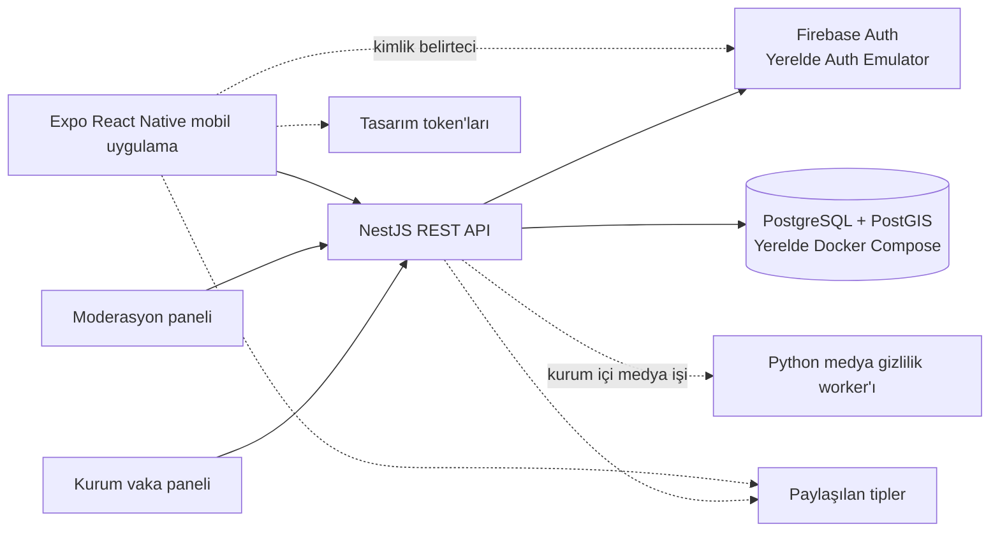

# dahatemiz

**Türkiye’den başlayarak çevresel sorunların güvenli biçimde bildirilmesini, topluluk katılımını ve doğrulanabilir
çevresel etkiyi bir araya getirmeyi amaçlayan mobil platform.**

dahatemiz vatandaşların çevresel sorunları fotoğraf/video ve konum bilgisiyle raporlayabilmesine; moderatörlerin
gönderileri incelemesine; yetkili kurumların ise yalnızca kendi organizasyonlarına ait dosyaları güvenli biçimde
değerlendirmesine yardımcı olur. Topluluk tarafında harita, etkinlikler, görevler ve olumlu katılımı ödüllendiren
özellikler bulunur.

> **Proje durumu — 21 Ekim 2026:** Faz 0–7 geliştirme kapsamı tamamlandı; Faz 8 pilot hazırlığı değerlendirildi. Bu depo
> şu anda yerel geliştirme ve test içindir, gerçek kullanıcı pilotuna hazır değildir. Rapor gönderim ekranı yerel demo
> modunda kalır. Henüz GCP projesi, üretim Firebase yapılandırması veya bulut depolaması oluşturulmadı. Gerçek veriye
> geçiş için hukuk/gizlilik kararları, fiziksel cihaz QA’sı ve açık altyapı onayı gerekir. Ayrıntılar:
> [`docs/PHASE8_READINESS.md`](docs/PHASE8_READINESS.md).

## Ürün ilkeleri

- Özgün kanıt dosyaları herkese açık URL’lerle sunulmaz; tasarlanan akış kısa ömürlü, yetkilendirilmiş erişim kullanır.
- Yeni raporlar otomatik olarak yayımlanmaz. Herkese açık içerik için insan moderasyonu gerekir.
- Yüz tanıma, kişileri teşhis etme ve otomatik yaptırım kararları kapsam dışıdır.
- Yapay zekâ/medya işleme çıktıları danışma niteliğindedir; hukuki kanıt veya otomatik karar olarak gösterilmez.
- Uygulama, demo verisini ve henüz bağlı olmayan entegrasyonları gerçekmiş gibi sunmamalıdır.
- KVKK, veri minimizasyonu, saklama ve silme politikaları mimarinin ön koşullarıdır.

## Mimari



Bu, **yerel geliştirme mimarisidir**. Planlanan bulut dağıtımı ancak bölge/veri yerleşimi, saklama, IAM ve bütçe
kararları ile açık onaydan sonra yapılabilir. GCP projesi ve üretim kaynakları oluşturulmuş değildir; Terraform
dosyaları yalnızca inceleme amaçlıdır.

| Alan                | Teknoloji ve sorumluluk                                                                                                                        |
| ------------------- | ---------------------------------------------------------------------------------------------------------------------------------------------- |
| Mobil               | Expo SDK 58, React Native 0.88, React 19, TypeScript strict, Expo Router                                                                       |
| API                 | NestJS 10, sürümlenmiş REST (`/api/v1`), DTO doğrulama, Firebase token doğrulama, rol/organizasyon yetkisi ve denetim kayıtları                |
| Veri                | PostgreSQL 16 + PostGIS; yerelde Docker Compose ve SQL migrasyonları                                                                           |
| Kimlik              | Yerel geliştirmede Firebase Auth Emulator (`demo-dahamiz`); gerçek Firebase projesi yapılandırılmadı                                           |
| Medya               | API üzerinden kısa ömürlü imzalı yükleme sözleşmesi; özel kanıt ve incelenmiş türevler için ayrı depolama tasarımı. GCS henüz yapılandırılmadı |
| Medya worker        | Python, FastAPI olmayan dahili HTTP worker ve OpenCV tabanlı gizlilik dönüşümü; bulgu insan incelemesine tabidir                               |
| Moderasyon/kurum    | `apps/admin-web` ve `apps/government-web` altında TypeScript/HTML/CSS panelleri; API tarafından yetkilendirilir ve yerelde çalışır             |
| Paylaşılan paketler | `@dahamiz/shared-types` API sözleşmeleri için; `@dahamiz/design-tokens` mobil semantik tema token’ları için                                    |
| Monorepo            | pnpm workspaces ve Turborepo                                                                                                                   |

### Rapor ve medya güven sınırı

Mobil istemci rapor taslağını cihazda saklayabilir; API’de kimliği doğrulanmış rapor ve medya istemci sözleşmeleri
bulunur. **Mobil rapor gönderim ekranı henüz bu API akışına bağlanmamıştır**: ekrandaki mevcut onay yalnızca yerel
demo/taslak saklamasını kapsar. Gerçek gönderim için onaylı rıza ve saklama metni, hesap/veri silme davranışı, özel
kanıt deposu ve uçtan uca fiziksel cihaz testi gerekir. Bu kapılar kapanana kadar gerçek rapor göndermeyin.

## Depo yapısı

```text
apps/
  mobile/           Expo Router tabanlı vatandaş uygulaması
  api/              NestJS API, SQL migrasyonları ve modüller
  admin-web/        Moderasyon paneli
  government-web/   Organizasyon kapsamlı kurum vaka paneli
packages/
  shared-types/     Uygulamalar arası TypeScript sözleşmeleri
  design-tokens/    Açık/koyu tema ve semantik görsel token'ları
services/
  media-worker/     Dahili medya/gizlilik dönüşüm servisi
infrastructure/
  docker/           Yerel PostgreSQL + PostGIS
  terraform/         Onay bekleyen GCP altyapı taslakları
docs/               Faz planı, ilerleme, mimari, güvenlik ve hazırlık kayıtları
```

## Gereksinimler

- Node.js `>=22.13.0`
- pnpm `>=9` (repo `pnpm@10.33.2` kullanır)
- Docker Desktop veya Docker Engine + Compose (yerel PostgreSQL/PostGIS için)
- Python 3 ve `services/media-worker/requirements.txt` bağımlılıkları (worker test/çalıştırma için)
- iOS Simulator veya Android Emulator (mobil cihaz testi için; fiziksel cihaz QA’sının yerine geçmez)

## Yerel geliştirme

### Kurulum

```bash
pnpm install
cp apps/api/.env.example apps/api/.env
cp apps/mobile/.env.example apps/mobile/.env
```

Örnek dosyalar yerel geliştirme değerleri içerir. `.env` dosyalarını repoya eklemeyin; üretim sırrı veya gerçek kimlik
bilgisi eklemeyin.

### Veritabanı ve Auth Emulator

```bash
docker compose -f infrastructure/docker/docker-compose.yml up -d
pnpm --filter @dahamiz/api db:migrate
pnpm dlx firebase-tools@latest emulators:start --only auth --project demo-dahamiz
```

Auth Emulator’ı ayrı terminalde açık tutun. Mobil `.env.example`, emulator için `127.0.0.1:9099` kullanır. Android
emülatöründe bilgisayardaki API/emulator’a erişmek için host adresi genellikle `10.0.2.2` olmalıdır; fiziksel cihazda
`localhost` yerine bilgisayarın yerel ağ adresi gerekir.

### Uygulamaları başlat

Her komutu ayrı terminalde çalıştır:

```bash
# API — http://localhost:3001, Swagger — http://localhost:3001/api/v1/docs
pnpm api:dev

# Expo Metro — QR kodundan Expo Go ile aç veya iOS/Android komutlarını kullan
pnpm mobile:start

# Panelleri ilk çalıştırmadan önce derle (sonraki değişikliklerde yeniden çalıştır)
pnpm --filter @dahamiz/admin-web build
pnpm --filter @dahamiz/government-web build

# Opsiyonel paneller
pnpm --filter @dahamiz/admin-web start
pnpm --filter @dahamiz/government-web start
```

Yerel paneller `http://127.0.0.1:4173` (moderasyon) ve `http://127.0.0.1:4174` (kurum) adreslerinde açılır. Kurum paneli
için emulator’da oluşturulmuş kullanıcıya uygun organizasyon üyeliği/rolü atanmış olmalıdır. Bu demo hesapları gerçek
kurum erişimi değildir.

## Doğrulama komutları

```bash
pnpm typecheck
pnpm lint
pnpm test:ci
pnpm build
pnpm format:check
pnpm --filter @dahamiz/api test:e2e
```

API ve medya worker HTTP testleri geçici olarak `127.0.0.1` üzerinde yerel sunucu açar. Test ortamı loopback soketini
engelliyorsa bu testlere izin vererek yeniden çalıştırın. Yerel emulator ve test verisi dışında gerçek kullanıcı, kurum
veya kanıt verisi kullanmayın.

## Mevcut kapsam ve sonraki kapılar

- **Tamamlanan mühendislik fazları:** Faz 0–7; mobil deneyim, temel API/veritabanı, topluluk özellikleri ve
  kurum/moderasyon panelleri için geliştirme kapsamı mevcut.
- **Açık pilot kapıları:** gerçek rapor gönderimi ve özel medya deposu, onaylı rıza/saklama/silme politikası, KVKK ve
  kurum anlaşmaları, fiziksel cihaz/a11y/ağ QA’sı, üretim izleme, bağımsız güvenlik incelemesi ve yayın/geri alma
  provası.
- **GCP:** proje, Cloud Run, Cloud SQL, Cloud Storage, üretim Firebase veya ücretli kaynak oluşturulmadı. Terraform
  `init`, `plan` veya `apply` çalıştırılmadı. Altyapı için
  [`infrastructure/terraform/README.md`](infrastructure/terraform/README.md) ve onay kapıları için
  [`docs/PHASE8_READINESS.md`](docs/PHASE8_READINESS.md) okunmalı.
- **Ürün backlog’u:** hikâye/video, yorumlar ve bazı harita/etki özellikleri henüz tamamlanmamış olabilir; güncel kapsam
  [`docs/FEATURE_BACKLOG.md`](docs/FEATURE_BACKLOG.md) ve [`docs/PROGRESS.md`](docs/PROGRESS.md) içindedir.

## Güvenlik ve katkı

Başlamadan önce [`AGENTS.md`](AGENTS.md), [`docs/PROGRESS.md`](docs/PROGRESS.md),
[`docs/PHASE_PLAN.md`](docs/PHASE_PLAN.md) ve [`docs/SECURITY_AND_PRIVACY.md`](docs/SECURITY_AND_PRIVACY.md) dosyalarını
inceleyin. TypeScript strict kuralları, erişim kontrolleri, insan moderasyonu ve mahremiyet sınırları zorunludur. Gerçek
bulut kaynağı oluşturmayın veya deploy etmeyin; ücretli kaynaklar ve üretim geçişi ayrıca açık onay gerektirir.

Bu depo için açık kaynak lisansı tanımlanmamıştır; proje özel kullanım içindir.
